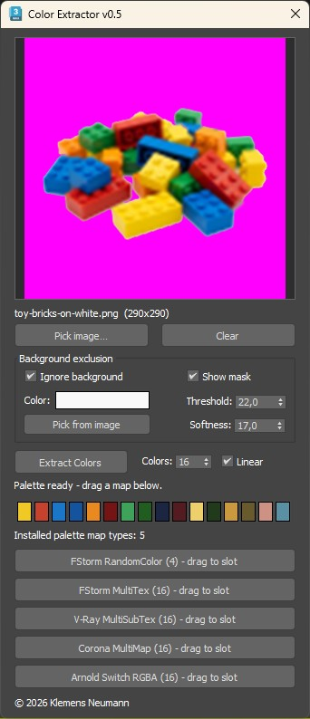

# Color Extractor

Extract a dominant-color palette from an image in 3ds Max and transfer it to native map nodes for Arnold, Corona, FStorm, or V-Ray. Extraction and color copying also work without these renderer plugins installed.

A personal helper shared as-is under the [MIT License](LICENSE). Updates and support are provided as time permits.



## Usage

To use the tool, just run `ColorExtractor.ms` in 3ds Max as described below. The validation tests are for developers and are not required for normal use.

1. Run `ColorExtractor.ms` through **Scripting > Run Script**.
2. Click **Pick image** to load a reference image.
3. Optionally enable **Ignore background**. Use **Pick from image** or the background color swatch to choose the color to exclude. Adjust **Threshold** and **Softness**; **Show mask** displays excluded pixels in magenta. Right-click the image to cancel picking.
4. Set **Colors** between 2 and 16. Enable **Linear** to convert extracted RGB values from sRGB to linear values.
5. Click **Extract Colors**. The palette is ordered from most to least prominent. Images with fewer distinct retained colors can produce fewer entries than requested.
6. Right-click a palette swatch to **Copy** its color, then **Paste** into a destination color swatch. Palette swatches are read-only; the separate background swatch remains editable.
7. Drag a generated map into a compatible material's map slot. Right-click an output button to clear that map; extract again to regenerate it.

Changing extraction settings clears the current palette and generated maps until you extract again. Toggling **Show mask** changes only the preview. The dialog has a fixed size.

## Supported map outputs

| Renderer | Map | Palette and selection behavior |
| --- | --- | --- |
| Arnold | Switch RGBA (`ai_switch_rgba`) | Up to 16 colors in inputs 0..N-1. **Index** selects the color and defaults to 0. No random driver is generated. Unused inputs repeat the first palette color. |
| Corona | MultiMap (`CoronaMultiMap`) | Up to 16 colors, with the active item count matching the palette. Randomizes by instance with equal frequencies. Mixing and hue, saturation, and gamma variation are disabled. |
| FStorm | RandomColor (`FStormRandomColor`) | Uses up to 4 or 8 colors according to the installed FStorm version, with equal chances. |
| FStorm | MultiTex (`FStormMultiTex`) | Up to 16 colors with sequential IDs starting at 1. The active item count matches the palette. Keeps the map's default ID-source mode. |
| V-Ray | MultiSubTex (`VRayMultiSubTex`) | Up to 16 colors with sequential IDs starting at 1. Keeps the map's default ID-source mode. Entries have equal probabilities if switched to Random mode; the default color is the first palette color. |

All outputs start empty and disabled. The tool discovers installed map classes when it opens and enables each output independently after extraction. An unavailable or incompatible map does not prevent the other outputs from working. Construction errors are reported in the MAXScript Listener.

Map creation does not change the active production renderer. Rendering the resulting map still requires a compatible renderer. Each adapter transfers the extracted RGB values without an additional conversion or texture override.

## Preferences

These settings load when the dialog opens and save when changed or when it closes:

| Setting | Default |
| --- | --- |
| Ignore background | Off |
| Threshold | 10.0 |
| Softness | 5.0 |
| Colors | 16 |
| Linear | On |

Preferences are stored in `ColorExtractor.ini` in 3ds Max's per-user plugcfg folder (`getDir #plugcfg`). Missing or invalid values use the defaults. The image, background color, palette, and generated maps are not saved.

## Extraction details

The tool clusters thumbnail pixels using weighted k-means in CIELAB space. **Colors** controls the clustering target, rather than trimming an existing 16-color palette. Results use deterministic sampling and initialization.

Background exclusion uses Lab color distance (Delta E 76). Pixels at or below **Threshold** have no influence; **Softness** controls the transition back to full influence. Matching colors are excluded throughout the image, including foreground details. Picking and matching use the original thumbnail, independently of **Linear** and the mask overlay.

Masked and transparent sources bypass extraction blur to avoid background bleed. Alpha reduces pixel influence when retained by the thumbnail loader. The magenta overlay never enters extraction.

## Requirements

Requires 3ds Max on Windows with its .NET components. Renderer outputs require their corresponding installed plugins. Plugin APIs have been checked in 3ds Max 2024; other plugin versions may expose different properties.

## Developer validation

The following checks are for developers testing changes to the tool. Users do not need to run them.

The script uses a native MAXScript UI, a .NET image preview, and an embedded C# helper compiled at runtime. Temporary compiler source is cleaned up after compilation. Palette swatches retain Max's native color clipboard; an input guard prevents opening their color editor, and incoming paste/drop changes are reset to extracted values.

Run the extractor checks from Windows PowerShell:

```powershell
powershell -NoProfile -ExecutionPolicy Bypass -File tests/Validate-Extractor.ps1
```

After loading the tool in 3ds Max, run these scripts through **Scripting > Run Script**:

- `tests/Validate-Rollout.ms`: preview, background picking, masking, extraction, FStorm outputs, and cleanup.
- `tests/Validate-RendererMaps.ms`: Arnold, Corona, and V-Ray outputs, reduced palettes, missing plugins, isolated failures, and cleanup.
- `tests/Validate-Preferences.ms`: defaults, saving and loading, invalid values, and control state.

UI checks replace the tool's loaded image and clear results. They avoid saving test settings to the user's preferences. Map checks inspect plugin properties without rendering and do not certify rendered color appearance.

© 2026 Klemens Neumann
